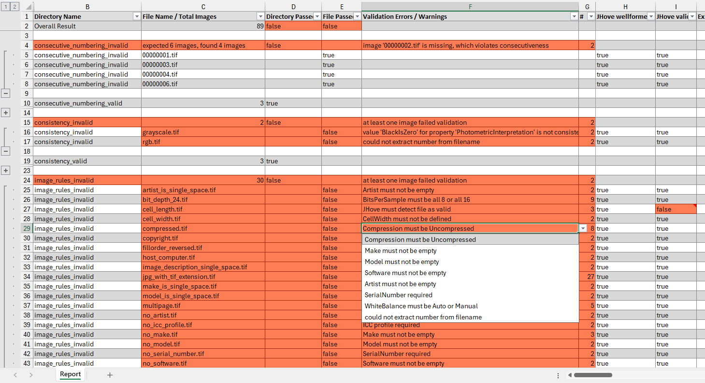

# StabiV

StabiV is a Java command-line tool for mass validation of image files. It checks image metadata against user-defined validation rules.
Metadata is extracted using [JHove](https://jhove.openpreservation.org/) and [ExifTool](https://exiftool.org/).

### Features

StabiV is able to

- check individual image files (e.g., "image width = 600px")
- check directories containing images files (e.g., "image width is the same for all files")
- generate a checksum file for each directory
- output validation results as JSON
- generate a CSV and Excel report

The following examples illustrate what kind of validation rules are supported:

- `Artist` is not empty
- Number of TIF IFDs equals 1
- `PhotometricInterpretation` is either `BlackIsZero` or `RGB`
- `XResolution` is the same as `YResolution`
- Either `ExifIFD.SerialNumber` or `XMP.SerialNumber` is not empty
- If `SubfileType` is defined, it has to be `Full-resolution image`
- `PhotometricInterpretation` is consistent for all images in a directory
- image files are numbered sequentially without any gaps, meaning `000001.tif`, `000002.tif`, etc.
- the `ImageWidth` of each image may deviate at most by 10 (pixels) from the average over all images of a directory

After validation, StabiV generates a customizable CSV and Excel report, highlighting failed validation rules for each image file as well and listing all extracted metadata values:

### Getting Started

StabiV may be installed both on Linux and Windows. Instructions can be found in the respective guides:

- [Getting Started on Windows](./documentation/getting-started/Windows.md)
- [Getting Started on Linux](./documentation/getting-started/Linux.md)

### Documentation

There is also a comprehensive [user guide](./documentation/userguide/README.md) explaining all validation rules, command line parameters, and configuration file options.

### License

StabiV is provided as open-source software and is licensed under the [GPLv3](./LICENSE).
